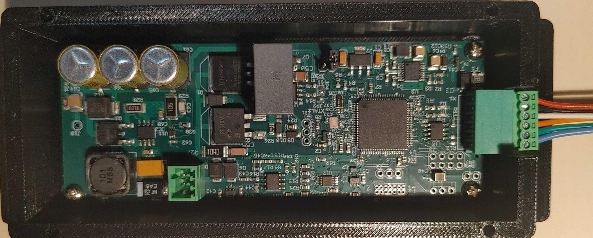

# TSR-900 Echosounder Hardware Manual

*Figure 1: TSR-900 Echosounder*

## Connector Pinouts

### RS-422 Connector (6-pin)

Located on the right side of the PCB in Figure 1.

| Pin | Color | Function | Connect To |
| --- | --- | --- | --- |
| 1 | Blue | Y (output) | -RXD |
| 2 | Green | Z (output) | +RXD |
| 3 | Orange | B (input) | -TXD |
| 4 | White | A (input) | +TXD |
| 5 | Black | Ground | Power supply ground and RS-422 ground |
| 6 | Red | Power (11 VDC to 16 VDC) | Power |

**Note:** Wire color selection is up to the end user and application.

### Transducer Connector (3-pin)

Located at the bottom left of the PCB in Figure 1.

| Pin | Function | Connect To Transducer |
| --- | --- | --- |
| 1 | Ground | Wire shield |
| 2 | Negative | Transducer negative |
| 3 | Positive | Transducer positive |

## Quick Start

The default communication speed is **115200 baud**.

The easiest sonar test is to use the Blue Robotics Ping Viewer software.

The TSR-900 outputs data in the **Ping1D** data format. The sonar automatically switches between the Blue Robotics protocol and TSR's own **"C" command JSON protocol**. In Blue Robotics mode, the TSR-900 Echosounder can emulate a Ping1D, or output high-resolution **16-bit magnitude data** with up to **5000 data points**.

### Recommended USB-to-RS-422 Adapter

Any USB-to-RS-422 adapter based on the FTDI chipset should work.

- [DTECH DT-5019 USB-to-RS-422/RS-485 converter](https://www.dtechelectronics.com/dtech-dt-5019-db9-serial-cable-usb2-0-male-to-rs422-rs485-serial-port-converter-cable_p559.html)
- [DTECH converter on Amazon Canada](https://www.amazon.ca/DTECH-Converter-Adapter-Supports-Windows/dp/B0195ZD3P4/)

### 6-pin 2.5 mm Terminal Block Connector

MECCANIXITY 4-set, 2.5 mm (0.1-inch) pitch, 6-pin PCB terminal block connector:

- [Amazon Canada](https://www.amazon.ca/MECCANIXITY-Connector-Pluggable-Terminals-Mechanical/dp/B0G4DWG1XX/)

### 3D-Printed Enclosure

`TSR-900_Echo_enclosure_rev1.scad`

### Python Example (TSR "C" Commands)

`TSR-ECHO-Fetch.py`

## High-Voltage Warning

> **WARNING — HIGH VOLTAGE (400 VDC)**
>
> Be extremely careful around the **right side of the PCB**, where the 400 VDC transmit voltage is generated. Touching this area during operation can cause a high-voltage electric shock.
>
> The high-voltage capacitors (**C61, C65, C66**) have a discharge resistor. It takes approximately **90 seconds** for the capacitors to discharge after power is turned off or disconnected.
